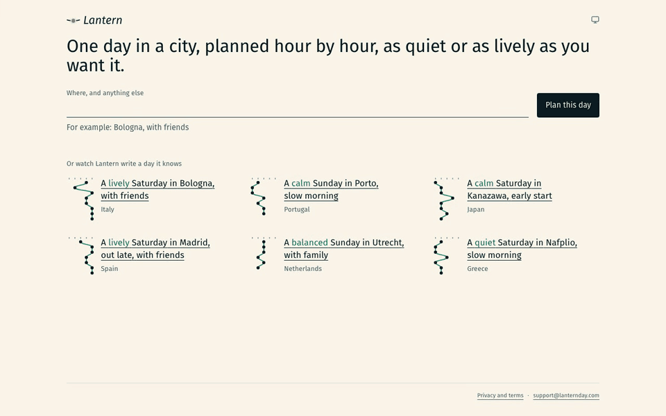
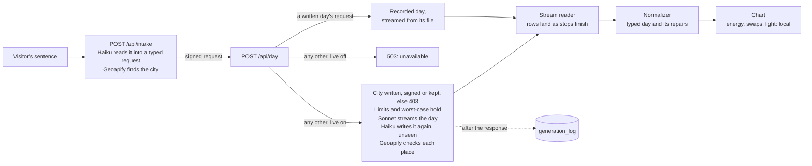

# Lantern



One day in a city, planned hour by hour, as quiet or as lively as you want it.

An adaptive, editorial day planner for travel. A generative model lays out the day as typed JSON constrained by Zod schemas; deterministic React components render it, stream it in without layout jumps, and let you reshape it locally. How the pieces fit: [`ARCHITECTURE.md`](ARCHITECTURE.md).

**Status:** live. Lantern has written days at [lanternday.com](https://www.lanternday.com) since 31 October 2026, behind per-visitor limits and daily and monthly spend caps. It also runs on a laptop with no keys: see [Getting started](#getting-started). See [`docs/roadmap.md`](docs/roadmap.md) for scope and dates, [`docs/decisions.md`](docs/decisions.md) for the reasoning behind the architecture, and [`docs/case-study.md`](docs/case-study.md) for the story in one read.

**Licence:** MIT ([`LICENSE`](LICENSE)).

**Branches:** `main` holds the releases, each tagged; work lands on `develop` first.

## How it was built

I built Lantern alone in three weeks by directing Claude Code sessions in set roles: engineering lead, product designer, evaluation, security, SEO and ops. I set the product, the date and the cut order, and made the calls on design, cost, privacy and what ships; agents wrote most of the code and first drafts of the docs, which I reviewed.

The setup they work in is part of the project. [`CLAUDE.md`](CLAUDE.md) is the working spec, and the roles' briefs are in [`.claude/agents/`](.claude/agents). Lint rejects any value outside the design tokens, a pre-commit gate runs every check, a fresh agent reviews UI work before it merges ([`.claude/skills/ui-review/`](.claude/skills/ui-review/SKILL.md)), and no agent spends on a live model call without my sign-off: a paid eval round refuses to start until `EVAL_CONFIRM_USD` covers its worst case.

The decisions log refers to me as "the owner".

Four of the product calls that were mine, each with its reasons:

- [No venue is named](docs/decisions.md#2026-10-30--lantern-names-no-restaurant-café-or-bar): a meal is a street or quarter and what is eaten there, since every place the model invented was a café, restaurant or bar, and naming one prefers it over its neighbours.
- [The curve picks among the versions the model wrote](docs/decisions.md#2026-10-22--the-energy-curve-stays-on-the-client-and-picks-among-the-versions-the-model-wrote), and a pull moves only the stops beside it, after a drag on a live day moved stops I had not touched.
- [The fork](docs/decisions.md#2026-11-08--a-changed-word-proposes-its-part-beside-the-day-and-the-visitor-takes-it), chosen over three other re-plan designs: a changed word proposes its part of the day beside the day, so a re-plan that fails changes nothing.
- [Sonnet kept over Haiku](docs/decisions.md#2026-10-28--sonnet-writes-the-day-and-haiku-writes-it-again-unseen-for-comparison), by measurement: Haiku is about 24 times cheaper per day, but leaves a third of its stops without versions for the curve to pick.

## Getting started

```bash
nvm use            # Node 24
corepack enable    # pnpm, pinned in package.json
pnpm install
pnpm dev
```

**It runs with no keys.** Without `.env.local`, the dev server is the product on its fourteen written days. The start screen reads a typed sentence in the browser and plays a written city's day; the curve, swaps and light work as in production; a changed word says what it would re-plan; and any other city is answered that Lantern isn't writing new days right now. Live generation on a laptop needs `LIVE_GENERATION=1`, `ANTHROPIC_API_KEY`, `VISITOR_HASH_SALT` and `GEOAPIFY_API_KEY`; without `DATABASE_URL` a laptop counts its limits in memory, while a deployment must have one (`src/lib/live/flag.ts`). Tests need none of them.

## Scripts

| Command            | Purpose                                                                                  |
| ------------------ | ---------------------------------------------------------------------------------------- |
| `pnpm dev`         | Dev server on http://localhost:3000                                                      |
| `pnpm dev:lan`     | The same, reachable from a phone on the local network                                    |
| `pnpm check`       | Format check, lint, typecheck, and unit tests with an 80% coverage gate: the commit gate |
| `pnpm test`        | The unit tests alone                                                                     |
| `pnpm e2e`         | Playwright on desktop and phone viewports                                                |
| `pnpm e2e:busy`    | `pnpm e2e` with each page's CPU twice as slow, as on a busy machine                      |
| `pnpm e2e:visual`  | The `/lab` matrices against their pixel baseline, which is drawn on macOS                |
| `pnpm build:check` | The production build, served and asked for its pages                                     |
| `pnpm format`      | Prettier, with Tailwind classes sorted                                                   |

`pnpm eval:table <dir>` writes the quality table below from a saved round, with no key. The rest need keys: `pnpm eval:live` runs a paid eval round, `pnpm log:report` and `pnpm events:report` read what live traffic did, `pnpm db:migrate` applies migrations, and `pnpm prod:read` reads production through a read-only role ([`docs/ops.md`](docs/ops.md)).

## Reading the code

1. [`ARCHITECTURE.md`](ARCHITECTURE.md): a request's life in one diagram, the folder map, six flows, and the words the code uses.
2. The six files it starts from:
   - `src/lib/schema/itinerary.schema.ts`: the data contract, and the test beside it that keeps it portable.
   - `src/lib/stream/outcome.ts`, then `src/lib/stream/read-day-stream.ts`: every way a stream ends, and what a cut one keeps.
   - `src/lib/normalizer/normalize.ts`: repair, refuse, and ids by position.
   - `src/lib/live/live-day.ts`, then `src/lib/live/streamed-call.ts`: the day route with its worst-case hold and its log, and the streamed call it makes.
   - `src/features/abacus/curve.ts`: the model writes the versions, and code picks among them.
   - `eslint.config.mjs` and `src/lib/lab-matrix.ts`: how the design system is enforced, and how a component is reviewed across its states.
3. [`docs/decisions.md`](docs/decisions.md): why, one entry per decision, each with what it costs.
4. [`docs/harness.md`](docs/harness.md): what checks the code and the model, what it measures, and what the measurements found.

## Quality

The day's quality checks (`src/lib/quality/`, run by the paid eval in `src/eval/`, listed in [`docs/harness.md`](docs/harness.md), "Eval harness") over a recorded live round: each request written by the day's model and by its shadow, and each place checked on Geoapify as the route would check it, a meal by its area and any other place by its name. A place left unconfirmed by name is not always made up: a walk named for a stretch of river has no name to find, and a real place whose point the model set a few hundred metres off is turned down, so that a similar name nearby cannot stand in for it. A day round spends money, so it calls nothing until `EVAL_CONFIRM_USD` names its worst case (`scripts/live-eval.ts`); the table is then written from what the round saved:

```bash
EVAL_ROUND=day EVAL_DAY_BODIES=src/lib/fixtures/live/golden-days.jsonl EVAL_OUT=<dir> EVAL_CONFIRM_USD=<worst case> pnpm eval:live
pnpm eval:table <dir>
```

<!-- eval-table:start -->

| Model             | Role   | Days complete | Places by name  | Meals by area    | Mean cost per day | Median to first token | Median to finish |
| ----------------- | ------ | ------------- | --------------- | ---------------- | ----------------- | --------------------- | ---------------- |
| claude-sonnet-5-5 | day    | 12 of 12      | 81 of 145 (56%) | 108 of 117 (92%) | $0.0818           | 1.4 s                 | 43.6 s           |
| claude-haiku-5-5  | shadow | 12 of 12      | 56 of 98 (57%)  | 104 of 108 (96%) | $0.0033           | 1.5 s                 | 22.6 s           |

| Check            | Kind   | Day: passed | Day: mean | Shadow: passed | Shadow: mean |
| ---------------- | ------ | ----------- | --------- | -------------- | ------------ |
| shape            | hard   | 12 of 12    |           | 12 of 12       |              |
| normalizes       | hard   | 12 of 12    |           | 12 of 12       |              |
| asked-words      | hard   | 12 of 12    |           | 12 of 12       |              |
| banned-phrases   | hard   | 12 of 12    |           | 12 of 12       |              |
| meal-name        | hard   | 2 of 12     |           | 3 of 12        |              |
| meal-name-lines  | scored | 12 of 12    | 0.54      | 12 of 12       | 0.71         |
| script           | hard   | 12 of 12    |           | 12 of 12       |              |
| escaped-letters  | hard   | 12 of 12    |           | 12 of 12       |              |
| alternatives-map | hard   | 12 of 12    |           | 11 of 12       |              |
| swap-direction   | scored | 5 of 12     | 0.87      | 1 of 12        | 0.53         |
| repairs          | scored | 9 of 12     | 2         | 6 of 12        | 3            |
| walk-radius      | scored | 6 of 12     | 0.88      | 5 of 12        | 0.79         |
| energy-fit       | scored | 12 of 12    | 0.94      | 10 of 12       | 0.89         |
| day-flow         | scored | 8 of 12     | 6866 m    | 7 of 12        | 5130 m       |
| leg-time         | scored | 10 of 12    | 10.75     | 11 of 12       | 5.83         |
| light-sense      | scored | 11 of 12    | 0.94      | 11 of 12       | 0.93         |
| time-words       | scored | 12 of 12    | 0.97      | 12 of 12       | 0.92         |

Round of 2026-11-05 on day-v10: the day on claude-sonnet-5-5, its shadow on claude-haiku-5-5; the golden set's 12 requests. Run 1 of three; the three runs' totals are in docs/harness.md, "Round A: Haiku against Sonnet".

<!-- eval-table:end -->

No check blocks a day a visitor sees: a hard check fails the day in the log and in the round, while the schema and the normalizer decide what is shown. `meal-name` became a measure, never a failure, the day this round ran, so the table still shows it as hard: `pnpm eval:table` reads the checks each run recorded, and a saved round cannot be scored again with new ones.

## Stack

Next.js 16 (App Router), React 19, TypeScript (strict), Tailwind CSS 4, Motion, Zod 4, Lucide, the AI SDK on Claude (`MODEL_IDS` in `src/lib/live/models.ts`: `claude-sonnet-5-5` writes the day and its re-plans, `claude-haiku-5-5` the shadow and the intake), Geoapify, and Postgres on Neon. Tests: Vitest, Testing Library, Playwright.

## Architecture

How a sentence becomes a day, in the order a request travels. The whole map, with every flow and folder, is [`ARCHITECTURE.md`](ARCHITECTURE.md). Why each piece is the way it is lives in [`docs/decisions.md`](docs/decisions.md); how each is tested and measured, in [`docs/harness.md`](docs/harness.md).



### The request path

1. **Intake** (`src/lib/intake/`). The start screen's text, at most 200 characters, is read by Claude Haiku into the request's typed words (`src/lib/schema/intake.schema.ts`), and its city is looked up on Geoapify. A name several cities share, "Portland" among them, plays the likeliest as Lantern's assumption, with the others a tap away; text that names no city becomes a question with the cities to choose from. The answer signs the city and its time zone, and the day route writes a city only under that signature, or a written or kept day's city, so it is not an open prompt endpoint.
2. **The day** (`src/app/api/day/`, `src/lib/live/live-day.ts`). A request equal to one of the fourteen written days, days Lantern wrote live (`src/lib/days/written/`), streams from its file through the same protocol and counts against nothing. Any other, with `LIVE_GENERATION=1`, passes the city's gate and the limits below, then Claude Sonnet streams the day through the AI SDK's `streamText` with `Output.object`, constrained to `GeneratedDaySchema`. Claude Haiku writes the same request beside it, never shown, so the two models can be compared on real traffic. Each place is looked up on Geoapify the moment its name, kind, quarter and coordinates are final, and its check rides in the same stream.
3. **The reader** (`src/lib/stream/`). The client parses the stream's partial JSON into rows as they arrive, and every way a stream can end is one of seven outcomes with its own screen (`outcome.ts`): complete, cut, disconnected, refused, invalid, unavailable, limited. A cut stream keeps the stops that arrived whole.
4. **On the page.** The energy curve re-picks among the versions the model already wrote, a swap changes which version a stop shows and never the day's data, and the light is computed from the sun's position: none of the three calls a model.

### The schema is the contract

- `src/lib/schema/itinerary.schema.ts` has two layers. The `Generated*` schemas are what the model is held to: portable across providers' structured-output grammars (no numeric, length or pattern keywords, strict objects, every field required, few union types, which a test enforces), with fields in the order the page draws them, so a stream fills the page from the top. The app-layer `Itinerary`, `Stop` and `Place` add ids, the request's context and invariants.
- The normalizer (`src/lib/normalizer/normalize.ts`) builds the app-layer day from a finished generation and returns the repairs it made, such as an option dropped for lying past the walking radius, or refuses a day it cannot make whole. The log counts the repairs.
- The model writes plain strings, never markdown or HTML. It describes light in named levels; code computes the sun.

### The design system

Every visual value is a token, and lint holds the code to them. `src/app/globals.css` declares a closed Tailwind theme, so only its colours, type sizes, spacing, widths and radii exist as classes, and each colour is a `light-dark()` pair that `data-theme` switches on any element. `eslint.config.mjs` rejects classes outside the theme, arbitrary values, raw colours, `dark:` overrides and literal inline styles, and `src/lib/tokens/token-lint.test.ts` proves each rule fires. `src/lib/tokens/palette.test.ts` holds text to 5:1 contrast and drawn marks to 3:1, and keeps the accents apart under simulated colour blindness. Anything that moves takes one of three springs named by intent (`src/lib/tokens/motion.ts`). Each component lists its states, densities and data extremes as plain data beside it, which `/lab/matrix` draws in both themes at a phone's width and a laptop's, under a pixel baseline (`pnpm e2e:visual`).

### What a call may cost

- **A visitor:** 10 days and 20 intakes per UTC day, counted under a salted hash of the address, never the address itself.
- **The app:** $10 a day and $95 a month, under the provider's monthly limit, so a bad month ends in `limited`, which offers the written days, rather than in errors.
- **Each call** holds its worst case (an input ceiling and its output cap at list price) before it starts, and settles at what it cost; a hold never settled expires after 10 minutes. Output caps: 12,000 tokens for a day and for its shadow, 6,000 for a re-plan, 1,000 for an intake. What the client sends is bounded at the edge.
- **The stores fail closed** (`src/lib/live/postgres-stores.ts`, Postgres on Neon): a database down or slower than 8 s answers 503 before any model call, and gives back what it took.
- **Tests never call a live service.** They run on a fake Claude API behind the real provider and on hand-written geocoder responses; a live eval round calls nothing until `EVAL_CONFIRM_USD` covers its worst case.

### The log, the checks and the eval loop

- Every model call is one row in `generation_log`: model, prompt version, tokens, cost, time to the first token and to the end, outcome, repairs, checks, the request. What a visitor typed is kept only on an intake's row, and cleared after 30 days.
- Seventeen checks (`src/lib/quality/checks.ts`) score a day: hard ones, such as shape, banned phrases and script, and scored ones held to thresholds, such as walking radius, energy fit, day flow, time to get between stops, light and the start, dinner and end words. A live day adds its place checks.
- The same checks run on every fixture before each commit, on every live day the log keeps, and in `pnpm eval:live` over the golden set of 12 day requests and the intake's own golden set. `pnpm eval:table` writes the table above; `pnpm log:report` reads live traffic the same way.
- Prompts are versioned in code (`DAY_PROMPT_VERSION`, `INTAKE_PROMPT_VERSION` and `REPLAN_PROMPT_VERSION` in `src/lib/live/`, now `day-v11`, `intake-v6` and `replan-v10`), and a round prints each check before and after, so a prompt change is judged on numbers. Each version and what it moved: [`docs/harness.md`](docs/harness.md#the-prompt-versions), "The prompt versions".

### Targeted re-plan

Each stop names the words of the request that shaped it (`dependsOn`). A changed start, dinner, end or company word rewrites only the stretches of the day it shaped (`replanPlanOf`, `src/lib/replan/windows.ts`), a time word's widened to any stop the new word leaves no room for. Travel, and a company word no stop names, change only the word, with no call: every stop stays. A time word no stop names, and windows that would hold more than two thirds of the stops, write the whole day again. The model receives the kept stops as bounded data and writes only the new ones, so it has no way to rewrite a kept stop.

The new part is a proposal: it is drawn on the chart beside the day, blue and dashed at its own hours, under a row that holds the visitor's answer and the new one, and the day stays the visitor's until they take it. A whole day written again stands under the same row, its stops not drawn beside the day, since two whole days share no hours to fork at. Either version is then one tap away, from memory, with no call. A re-plan is all or nothing: one that leaves a window empty, or whose merge drops a new stop, fails, and the day, never touched, stays as it was. The route, the merge, the page's view and a golden set of six are built ([`docs/targeted-replan.md`](docs/targeted-replan.md); `docs/decisions.md`, "A changed word proposes its part beside the day, and the visitor takes it").

### Days kept to be opened again

A live day is written to its end even when the visitor leaves; its answer names its row in an `X-Lantern-Day` header, and `GET /api/day/<id>` opens it for 30 days. The visitor's list of their days lives in their browser; the server keeps no key of theirs.

### Not built, on purpose

- **No accounts.** A visitor's days live in their own browser, their counts under a salted hash of the address and their product events under a key that changes every UTC day, so the server holds nothing that names a person.
- **No thinking on the calls, for now.** Thinking is billed as output and spent before the first words, and the schema already orders a day's fields.
- **No venues named for meals.** A meal is a street or quarter to eat around, and what is eaten there: every place Sonnet invented in the first live passes, 29 of 408, was a café, restaurant or bar, and a named business brings hours and closings Lantern cannot stand behind.
- **No Google Places.** It needs a card on file and has no monthly cap; Geoapify's free plan needs no card, so the places cannot run up a bill.
- **No model judges what a visitor sees.** A person's rubric defines the voice ([`docs/voice.md`](docs/voice.md)). A model judge applies it in eval rounds only (`src/eval/voice/judge.ts`), and its numbers compare writers, never give an absolute share; the checks score what code can decide.
- **No shadow for re-plans:** their golden set of six runs on the day's model alone ([`docs/targeted-replan.md`](docs/targeted-replan.md)).

## Licence

The code is under the MIT licence, in [`LICENSE`](LICENSE). A few test fixtures keep small extracts of map data, © OpenStreetMap contributors under the ODbL and recorded from Geoapify; [`NOTICE`](NOTICE) names them and their terms. The bundled Literata in `assets/fonts/` keeps its own SIL Open Font License 1.1, in [`assets/fonts/OFL.txt`](assets/fonts/OFL.txt) beside it.
